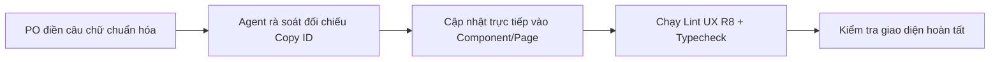

# HỆ THỐNG NỘI DUNG GIAO DIỆN (UI COPY DECK) — FLORAOS PRODUCTION

> **Ngày khởi tạo**: 10/10/2026  
> **Mục đích**: Bảng đối chiếu và chuẩn hóa 100% câu chữ hiển thị trên giao diện của 10 chức năng đang hoạt động (active) trên môi trường Production của FloraOS.  
> **Người biên tập / Chuẩn hóa**: Chủ sản phẩm (PO / Merchant Admin).  
> **Trạng thái**: Chờ điền nội dung chuẩn hóa mới.

---

## 1. Danh sách 10 mục Production được bóc tách nội dung

| # | Mã phân hệ | Tên màn hình / Mục sidebar | Tuyến đường (Route) | File tài liệu chi tiết |
|---|---|---|---|---|
| 1 | `HOME` | **Trang chủ** (Hành trình tác vụ) | `/` | [01-trang-chu.md](./01-trang-chu.md) |
| 2 | `ORDER` | **Đơn hàng & Kênh chào bán** | `/don-hang` | [02-don-hang.md](./02-don-hang.md) |
| 3 | `CARD` | **Thẻ chào mẫu hoa** | `/the-chao` | [03-the-chao.md](./03-the-chao.md) |
| 4 | `PRODUCT` | **Sản phẩm & Giá** | `/san-pham` | [04-san-pham-va-gia.md](./04-san-pham-va-gia.md) |
| 5 | `CREATE` | **Tạo mẫu hoa mới** | `/san-pham/tao-moi` | [05-tao-mau-hoa-moi.md](./05-tao-mau-hoa-moi.md) |
| 6 | `IMPORT` | **Nhập từ Excel & Ảnh** | `/san-pham/nhap-hang-loat` | [06-nhap-tu-excel.md](./06-nhap-tu-excel.md) |
| 7 | `SCAN` | **Quét ảnh hoa** | `/tai-anh` | [07-quet-anh-hoa.md](./07-quet-anh-hoa.md) |
| 8 | `MEDIA` | **Kho dữ liệu** | `/kho-du-lieu` | [08-kho-du-lieu.md](./08-kho-du-lieu.md) |
| 9 | `PROFILE` | **Hồ sơ cửa hàng** | `/ho-so` | [09-ho-so-cua-hang.md](./09-ho-so-cua-hang.md) |
| 10 | `SETTING` | **Cài đặt hệ thống** | `/cai-dat` | [10-cai-dat.md](./10-cai-dat.md) |

---

## 2. Quy ước đặt Mã định danh phần tử (Copy ID)

Mỗi câu chữ đều được gắn một **Mã định danh duy nhất (Unique Copy Key)** theo cấu trúc:
```text
[MÃ PHÂN HỆ]-[LOẠI THÀNH PHẦN]-[SỐ THỨ TỰ]
```

### Bảng ký hiệu loại thành phần:
* `HDR`: Tiêu đề chính, tiêu đề phụ, breadcrumb (`Header / Title / Subtitle`)
* `TAB`: Tên tab chức năng, nhãn phân luồng (`Tabs`)
* `BTN`: Nút bấm, liên kết tác vụ, hành động (`Button / Action / CTA`)
* `LBL`: Nhãn trường nhập liệu, tiêu đề nhóm (`Field Label / Section Label`)
* `PH`: Văn bản gợi ý mờ trong ô nhập (`Input Placeholder`)
* `HLP`: Chú thích hướng dẫn phụ dưới ô nhập liệu (`Helper Text`)
* `TH`: Tiêu đề cột trong bảng (`Table Header`)
* `BDG`: Huy hiệu, nhãn trạng thái (`Badge / Status Tag`)
* `GDC`: Khối hướng dẫn thao tác chuẩn (`Feature Guidance Card`)
* `EMP`: Trạng thái khi chưa có dữ liệu (`Empty State`)
* `MOD`: Tiêu đề, nội dung cảnh báo trong hộp thoại (`Modal / Dialog`)
* `MSG`: Thông báo nổi góc màn hình (`Toast / Success / Error Message`)

---

## 3. Hướng dẫn cách điền và chuẩn hóa

Trong mỗi file tài liệu chi tiết:
1. **Cột "Nội dung HIỆN TẠI trên UI"**: Là câu chữ chính xác đang chạy trong mã nguồn hiện tại.
2. **Cột "Nội dung BẠN CHUẨN HÓA (Mới)"**: Là ô trống để bạn nhập câu chữ mong muốn.
   - *Nếu giữ nguyên:* Có thể để trống hoặc ghi `-`.
   - *Nếu thay đổi:* Gõ trực tiếp câu chữ mới bạn muốn hiển thị.
3. **Ký hiệu biến động `{{...}}`**: 
   - Một số câu chữ có chứa biến số động (ví dụ: `Tổng cộng: {{count}} đơn hàng`, `Chào {{shopName}}!`). 
   - Khi chỉnh sửa, vui lòng **giữ nguyên phần trong ngoặc nhọn `{{...}}`** để hệ thống tự động điền số liệu.
4. **Quy tắc giọng điệu (Tone of Voice) cho Cửa hàng hoa**:
   - Tươi sáng, thanh lịch, tinh tế và ấm áp.
   - Trực quan, dễ hiểu đối với nhân viên bán hoa, thợ cắm hoa và chủ tiệm.
   - Tuyệt đối tránh từ ngữ kỹ thuật lập trình (như *ID, Payload, Response, Render, Record, Null...*).

---

## 4. Quy trình áp dụng ngược lại vào Mã nguồn


Sau khi bạn điền xong bất kỳ file nào, Agent sẽ đọc trực tiếp cột mới và cập nhật thẳng vào file mã nguồn tương ứng.
